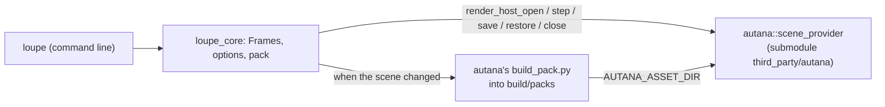

# Loupe

Loupe is a frame debugger for the [autana](https://github.com/jose-villegas/autana)
engine. It runs autana's own drawing code on a desktop, so the frame it shows
is the frame the device draws. Today it renders a scene file to an image or a
video from the command line; a window with a scrubber and a view picker comes next.



## Build

You need GCC (MinGW-w64 on Windows), CMake 3.21 or newer and Python 3.11 or
newer, which autana's pack tool runs on.

```bash
git clone --recurse-submodules https://github.com/jose-villegas/loupe
cmake -S loupe -B loupe/build -DCMAKE_C_COMPILER=gcc -DCMAKE_CXX_COMPILER=g++
cmake --build loupe/build --parallel
```

`-DAUTANA_DIR=<path>` builds against another autana checkout instead of the submodule.

## Render a scene

```bash
loupe/build/loupe loupe/third_party/autana/launcher/demo/sponza/sponza.scene.toml --view meshlets --frames 60 -o sponza.bmp
```

| Flag | Meaning |
|---|---|
| `--object NAME` | draw only this renderer and its children; repeatable |
| `--camera NAME` | the camera to look through; the scene's first by default |
| `--view NAME` | `shaded` or a debug view; an unknown name lists them |
| `--frames N`, `--dt MS` | how many frames, how far apart (30 at 16 ms) |
| `--set owner.name=value` | a tunable; repeatable |
| `-o out.bmp`, `--video out.avi` | the last frame, every frame |

The flags are autana's `scene_viewer.sh` flags, and the output is the same bytes.
The scene's pack is built on the first run and again only when its folder changes.

## Tests

`ctest --test-dir loupe/build` runs:

| Test | Checks |
|---|---|
| `parity_*` | `loupe` writes the same bytes as autana's `scene_viewer.sh` for the same arguments |
| `seek` | a seek back through a checkpoint draws the bytes stepping straight there drew |
| `include_gate` | only `src/engine/autana.h` includes autana's headers |

CI runs them on Linux and Windows at the pinned autana on every pull request,
and nightly against autana's `main`, keeping one issue open while that fails.

## License

GPL-3.0, as autana.
