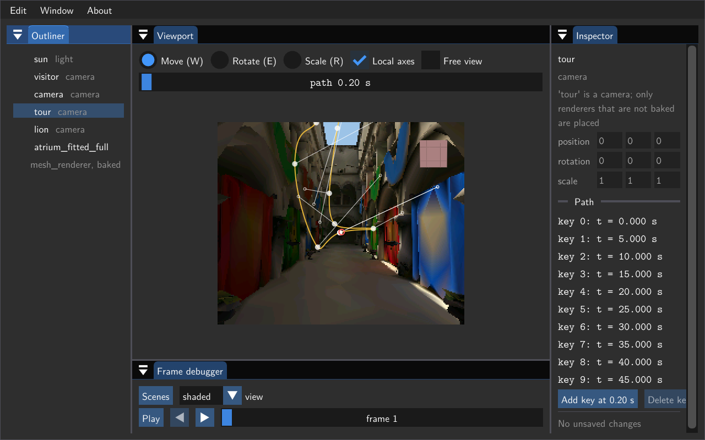
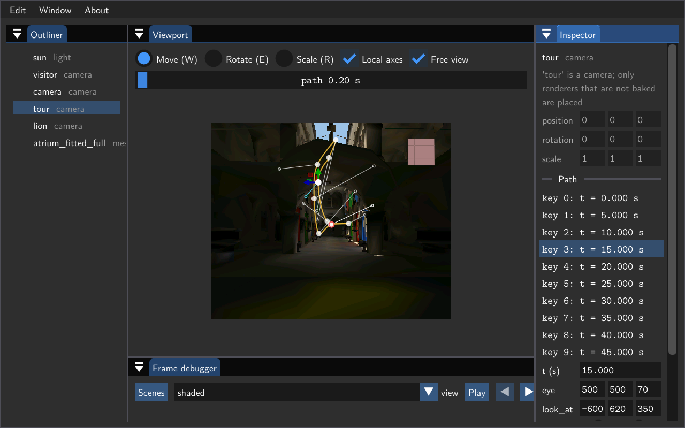
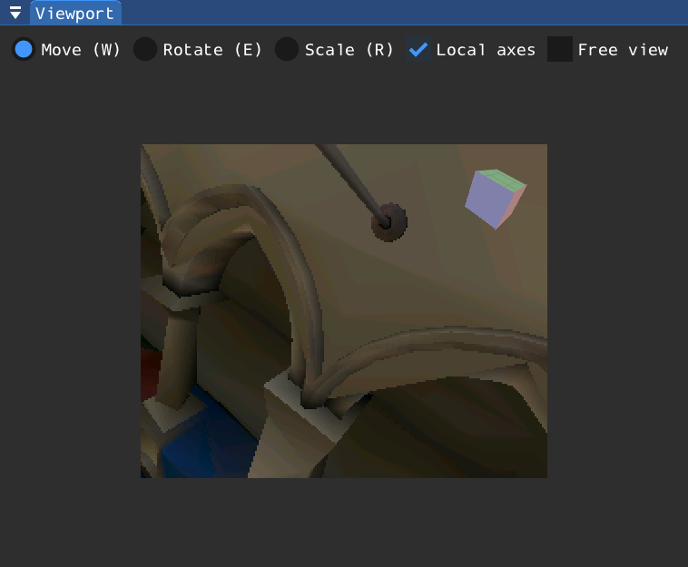
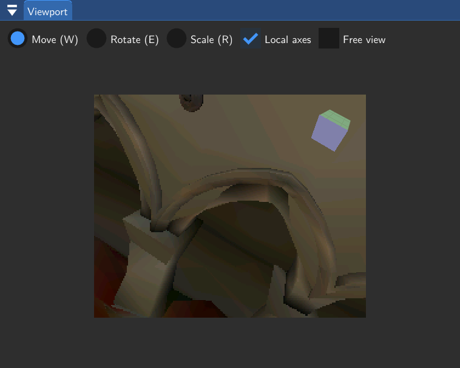
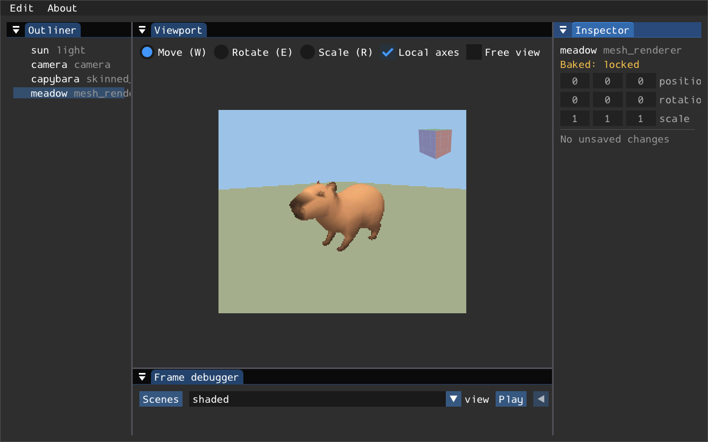
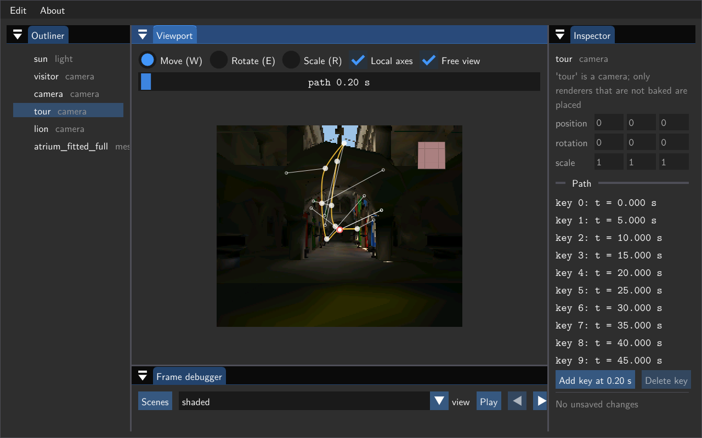

# Loupe

Loupe is a frame debugger and scene editor for the
[autana](https://github.com/jose-villegas/autana) engine. It runs autana's own
drawing code on a desktop, so the frame it shows is the frame the device draws.
It opens a scene in a window with a timeline and a debug-view picker, moves the
scene's objects and saves them back, or renders it to an image or a video from
the command line. It also shows a board's frames live, drawn again from the
render input the board streams, and records them for later. A scene is an asset pack (`.apak`), or a `.scene.toml` Loupe
builds the pack of first.


Every picture of the window here is drawn by Loupe itself: a recipe in
[`tests/stories/doc_shots`](tests/stories/doc_shots) clicks and types its way
to it on the real window ([Recipes](docs/development/Recipes.md)).

| | |
|---|---|
|  |  |
| A camera's path: its curve, its keys and the scrub bar | A key's eye moved: the curve bends to it |
|  |  |
| Through the tour at 18 s, on the path the pack was built with | The same frame, the camera flying the edited path |
|  |  |
| A baked renderer, locked where its lighting was traced | Free view, flown back so the whole tour is in sight |

## Quick start

Download `loupe-<version>-windows-portable.zip` from the
[latest release](https://github.com/jose-villegas/loupe/releases), unzip it and
run `loupe.exe`: the start panel lists a sample of every autana demo scene.
A setup and a Linux tarball sit beside it ([Download](docs/start/Download.md)).

To build it instead ([Build](docs/start/Build.md)):

```bash
git clone --recurse-submodules https://github.com/jose-villegas/loupe
cd loupe
pip install -r tools/ci/requirements.txt
cmake --workflow --preset default
build/default/loupe third_party/autana/launcher/demo/sponza/sponza.scene.toml
```

## Documentation

| Folder | Covers |
|---|---|
| [Getting started](docs/start/README.md) | the downloads, updates, and building from source |
| [The editor](docs/editor/README.md) | opening a scene, moving its objects, editing camera paths |
| [A board](docs/board/README.md) | the live view of a board, recording its frames, replaying a recording |
| [Rendering from the command line](docs/render/README.md) | frames, videos, every flag, A \| B compares |
| [Developing Loupe](docs/development/README.md) | the architecture, the tests, recipes, the standards, releases |

## License

GPL-3.0, as autana. A build with `-DLOUPE_STORYBOARD=ON`, as the `default`
preset is, links [Dear ImGui Test Engine](https://github.com/ocornut/imgui_test_engine),
under its own licence, into every program it builds, `loupe` too; the downloads
are built without it (the `release` preset).
The panels' typefaces, Latin Modern Sans and Mono, are under the
[GUST Font License](assets/fonts/GUST-FONT-LICENSE.txt). The braille patterns
the wait spinner draws are DejaVu Sans's, cut down to U+2800-28FF, under
[DejaVu's licence](assets/fonts/DEJAVU-LICENSE.txt).
