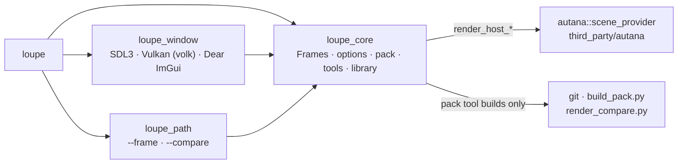

# Loupe

Loupe is a frame debugger for the [autana](https://github.com/jose-villegas/autana)
engine. It runs autana's own drawing code on a desktop, so the frame it shows
is the frame the device draws. It opens a scene in a window with a
timeline and a debug-view picker, or renders it to an image or a video from the
command line. A scene is an asset pack (`.apak`), or a `.scene.toml` Loupe
builds the pack of first.



## Download

Each [release](https://github.com/jose-villegas/loupe/releases) has three
downloads, unsigned, so Windows SmartScreen warns on their first run. Each holds
a pack of every autana demo scene as a sample, listed on the start panel. They
need no Python and no compiler; the window needs a Vulkan driver.

| Download | Holds | To run it |
|---|---|---|
| `loupe-<version>-windows-portable.zip` | `loupe.exe`, `scenes/`, `LICENSE` | unzip anywhere and run `loupe.exe` |
| `loupe-<version>-windows-setup.exe` | the same files, installed into Program Files with a Start menu entry and a desktop shortcut; `.apak` files then open in Loupe | run it; uninstall from Windows' installed apps, which removes the shortcuts and the `.apak` association too |
| `loupe-<version>-linux-x86_64.tar.gz` | `bin/loupe`, and in `share/` the samples, `applications/loupe.desktop` and the icon | run `bin/loupe` where it lands, or copy `bin/` and `share/` into `~/.local` to list Loupe among the desktop's applications |

The Linux build is made on Ubuntu 24.04 with GCC's runtime linked in, so it
needs only glibc 2.39 or newer, X11 or Wayland, and a Vulkan driver.

The [main build](https://github.com/jose-villegas/loupe/releases/tag/main-build)
pre-release holds the same downloads built from the latest push to `main`,
named `main` in place of the version (`loupe-main-windows-portable.zip`), so
its links stay the same.

About, on the window's menu bar, or `loupe --version`, names the build:

```text
loupe 0.1.0 (1a2b3c4d5, main build, portable), autana 262e7d0ab
```

| Part | Says |
|---|---|
| `0.1.0` | the version |
| `1a2b3c4d5` | Loupe's commit |
| `main build` | the channel it was built for: `release` from a version tag, `main build` from `main`, `local build` from anywhere else (`-DLOUPE_CHANNEL=None`, the default) |
| `portable` | `installed` for the setup's copy, else `portable` |
| `262e7d0ab` | the autana commit it was built against |

### Updates

A downloaded Loupe keeps itself current. About's **Updates** picks what it
follows; each copy starts on its own channel, and a local build never updates.

| Updates | Takes |
|---|---|
| Off | nothing |
| Official releases | the latest release, when its version is higher than this copy's |
| Main builds | the main build, when it is of another commit than this copy |

Each time the window opens, Loupe asks GitHub once, in the background. A newer
build is downloaded and checked against GitHub's SHA-256 digest of the file,
then kept in Loupe's settings folder (`%APPDATA%\autana\loupe` or
`~/.local/share/autana/loupe`) until the window closes. Then it takes this
copy's place: a portable copy's files are replaced, the running `loupe` renamed
aside until the next start; an installed copy runs the new setup silently,
which asks Windows for permission once. The next start's About says what it was
updated to. It downloads and unpacks with the system's own `curl` and `tar`,
nothing ever pops up, and every step is logged to `update.log` in the settings
folder. Runs with `-o`, `--video` or `--ticks` never update.

## Build

You need GCC (MinGW-w64 on Windows), CMake 3.25 or newer and the Python
autana's pack tool runs on (`third_party/autana/scripts/lib/python-min-version`);
without the tests, `-DLOUPE_PACK_TOOL=OFF -DBUILD_TESTING=OFF` builds a Loupe
that opens `.apak` files only and needs no Python.
On Linux, also the packages in `tools/ci/linux-packages.txt`, which
`tools/ci/install-linux-packages.sh` installs. The window draws through Vulkan,
loaded when it opens, so the build needs no Vulkan SDK.

```bash
git clone --recurse-submodules https://github.com/jose-villegas/loupe
cd loupe
pip install -r tools/ci/requirements.txt
cmake --workflow --preset default
```

`cmake --preset default -DAUTANA_DIR=<path>` configures against another autana checkout instead of the submodule.

## Open a scene

```bash
build/default/loupe third_party/autana/launcher/demo/sponza/sponza.scene.toml
```

Run without a scene, the window opens on a start panel: the sample packs beside
`loupe` (`scenes/`, or `../share/loupe/scenes/` when installed), the last 10
scenes opened, and Open... for any other. A scene picked there opens in this
window with the scene's own defaults. Scenes, in a
scene's window, closes the scene and goes back to the panel. The recent list is `recent.txt` in
`%APPDATA%\autana\loupe` on Windows and `~/.local/share/autana/loupe` on Linux.

The window shows the engine's frame at the largest whole zoom that fits. Play
steps one frame per display refresh; the arrows and the scrubber seek through
checkpoints, so a frame sought is the frame stepping straight there drew. The
view picker draws the frame on screen again under another debug view.

A view that draws the frame a second time from elsewhere, such as `cull`,
shows an observer checkbox. While it is on, the timeline pauses and the shown
frame is drawn again from a camera the person flies, the frame's own camera
left where its path put it: W, A, S and D move, Q and E go down and up,
dragging with the right button looks round, and the wheel scales the speed,
which starts at crossing the scene's box corner to corner in 20 seconds.
autana's `fly_motion` flies it. Each move costs one engine frame, from a
checkpoint held just before the shown frame. Unticked, or with another view
picked, the frame is the straight run's again.

## Render a scene

With `-o` or `--video`, Loupe writes the frames and exits, without a window:

```bash
build/default/loupe third_party/autana/launcher/demo/sponza/sponza.scene.toml --view meshlets --frames 60 -o sponza.bmp
```

| Flag | Meaning |
|---|---|
| `--object NAME` | draw only this renderer and its children; repeatable |
| `--camera NAME` | the camera to look through; the scene's first by default |
| `--view NAME` | `shaded` or a debug view; an unknown name lists them |
| `--frames N`, `--dt MS` | how many frames, how far apart (30 at 16 ms) |
| `--set owner.name=value` | a tunable; repeatable |
| `-o out.bmp`, `--video out.avi` | the last frame, every frame |
| `--checkpoint-mb MB` | the window's checkpoint memory (1024); past it, every other checkpoint goes |
| `--ticks N` | closes the window after N ticks, for scripted runs |
| `--version` | prints the build's version, commit, channel and autana commit (Download), and exits |

The flags but the last three are autana's `third_party/autana/launcher/tools/render/scene_viewer.sh` flags, and the output is the same bytes.
A `.apak` opens as it is: its folder is the asset dir, its name the scene id.
A `.scene.toml` run first brings the scene's pack in `build/packs` up to date
with autana's `third_party/autana/launcher/tools/r3d/build_pack.py`; a build
with `-DLOUPE_PACK_TOOL=OFF` refuses one, and says so.

## Frames of a camera path, and A | B compares

`--frame N -o out.png` writes frame N of the scene's camera path as a PNG, the
pixels a run of `--frames N+1` at the same `--dt` writes with `-o`. `--compare REV|DIR` draws the
path twice: side A is the scene given, side B the same `.scene.toml`'s pack
built by B's own copy of `third_party/autana/launcher/tools/r3d/build_pack.py`,
in a git worktree at the revision REV of
the scene's repository (removed after) or in the checkout DIR. Both sides are
drawn by this Loupe, one after the other. `--b-args "FLAGS"` gives B its own
`--object`, `--camera`, `--view` and `--set` flags in place of A's, so
`--b-args ""` draws B with none.

```bash
loupe sponza.scene.toml --frame 120 -o f.png
loupe sponza.scene.toml --compare main --video ab.mp4
loupe sponza.scene.toml --compare . --b-args "--view meshlets" --frame 120 -o f.png
```

| Command | Writes |
|---|---|
| `--frame N -o out.png` | frame N; with `--compare`, A's to `out.png` and B's to `out-b.png` |
| `--compare REV\|DIR --video out.mp4` | every frame of the path as A \| B \| difference x8, each frame labelled with its index and time, by autana's `render_compare.py --video`; its numbers per frame go to `out.csv` |

Both time the path alike, so frame N of a video is what `--frame N` writes:
`--dt` when given, else the scene's own frame time, or the shortest whole
millisecond at which the path fits one video when it does not at that;
`--frames` when given, else the whole path. A frame past the path's end, a
revision that does not exist and a checkout without the scene exit 2 saying
why. `--compare` needs the pack tool, git, ffmpeg and the Python modules in
`third_party/autana/launcher/tools/render/requirements.txt`; a build with
`-DLOUPE_PACK_TOOL=OFF` refuses it, and says so.

## Tests

The preset's test step (`ctest --preset default`) builds the packs it opens with `third_party/autana/launcher/tools/r3d/build_pack.py`, then runs:

| Test | Checks |
|---|---|
| `parity_*` | `loupe` on the scene's `.apak` (and, with the pack tool, its `.scene.toml`) writes the same bytes as autana's scene viewer for the same arguments |
| `scene_toml_refused`, `compare_refused` | without the pack tool, a `.scene.toml` exits 1 and `--compare` exits 2, saying why |
| `wrong_version_refused` | a pack of another format version exits 1 with autana's reason |
| `reopen_*` | a scene opened again after another closed, in one process, draws what it drew opened first; a pack of the same name from another folder is read afresh, so the window switches scenes in one process |
| `path_flags` | `--frame`, `--compare` and `--b-args` parse only with what they need, and B takes `--b-args`' flags in place of A's |
| `path_timing` | a path is timed as described under Frames of a camera path |
| `frame`, `frame_compare`, `frame_compare_head` | `--frame`'s PNG, alone and for both sides against a folder and against `HEAD`, holds the pixels a straight run to that frame writes; under other `--b-args`, B's differs from A's |
| `compare_same`, `compare_view` | a compare video's difference is nothing on every frame against the same pack, and something under another `--view`; skipped without ffmpeg, numpy or Pillow |
| `frame_past_end`, `compare_bad_rev`, `compare_no_scene` | exit 2 with the reason |
| `run_logged` | a tool loupe runs, from a folder named outside any one Windows code page, gets its arguments and paths intact and its output lands in the log (on Windows, through the UTF-8 code page manifest, `src/windows/utf8.manifest`) |
| `library` | the start panel's samples, and a recent list kept most recent first, each once, at most 10 |
| `seek` | a seek back through a checkpoint draws the bytes stepping straight there drew |
| `thinning_*` | under a checkpoint budget the checkpoints stay within it, their interval doubles, and seeks still draw the straight bytes |
| `observe` | under `cull`, each observer move draws one frame and the same pose draws the same bytes; turned off, or left by a seek either way, a view pick or closing (the image `-o` writes), the frames are the straight run's |
| `observer_steer` | the observer starts at the speed that crosses the scene's box in 20 seconds; W, A, S, D, Q and E are its axes unless a text field has the keys, a right drag looks only when it began over the frame, and the wheel counts only over it |
| `view_switch` | a debug view picked mid-run, and kept through a seek back, draws what it drew when picked from the start |
| `window_smoke`, `window_start` | the window opens, on a scene and on the start panel, and draws 10 ticks offscreen on Mesa's lavapipe under the Khronos validation layer, with no validation error; skipped where either is missing |
| `version` | `--version` names the project version, Loupe's commit, the configured channel and the autana commit |
| `update` | SHA-256 on the standard's examples; GitHub's saved release answers give each system's download; which offers are newer; the setting; a check stages only a verified newer download and a local build never asks; a running copy, beside its samples and in `bin/`, is swapped for a staged one and says so at its next start |
| `build_id` | `--version`'s line for each channel, and a copy counts as installed only with the setup's uninstaller beside it |
| `include_gate` | only `src/engine/autana.hpp` includes autana's engine headers; autana's packages, below the engine, are open to every file |

CI runs them on Linux and Windows at the pinned autana on every pull request,
and nightly against autana's `main`, keeping one issue open while that fails.

## Standards

Loupe is held to autana's code standards by autana's own gates, run from the
submodule: they check the repository they run in. `.github/workflows/standards.yml`
runs them, and [autana's C++ style](third_party/autana/docs/c-style/Cpp.md) is
what they enforce. The build takes its flags, sanitizers and clang-tidy from
`third_party/autana/scripts/cpp/standards.cmake`, and `CMakePresets.json` builds each:

| Preset | Builds and tests |
|---|---|
| `default` | with every warning an error |
| `sanitize` | under UBSan, and ASan on Linux, without the pack tool |
| `tidy` | with clang-tidy (`.clang-tidy`) on every C++ file |
| `release` | optimized, without the pack tool and with every demo scene's pack as a sample, then `cpack`'s downloads into `build/release`; on Windows the setup needs NSIS's `makensis` on `PATH` |

```bash
cmake --workflow --preset sanitize
```

The presets use Ninja; `pip install -r tools/ci/requirements.txt` installs it with
the clang-format and clang-tidy autana pins. To run the gates before each commit,
and the sanitized tests before each push that changes C++ or CMake:

```bash
git config core.hooksPath third_party/autana/scripts/git-hooks
```

`.clang-format` and `.clang-tidy` are generated by
`third_party/autana/scripts/cpp/style_configs.py`; CI fails when they drift from the pin.

## Release

`project(loupe VERSION ...)` in `CMakeLists.txt` is the one version. Bump it, merge,
then push the tag `v<version>` on that commit. `.github/workflows/build.yml`
runs the `release` workflow preset on Windows and Linux, unpacks each download
into an empty folder and renders every sample in it with nothing on `PATH`
(`tools/ci/package_smoke.sh`), and on Windows installs the setup silently,
renders every sample from the installed `loupe.exe`, uninstalls it and checks
that no file, shortcut or registry key is left (`tools/ci/installer_smoke.sh`).
It then attaches the downloads to the tag's
GitHub Release, and refuses a tag that names another version. Every pull
request and nightly run builds and smoke-tests the downloads the same way,
without publishing them. A tag `v<version>-rc.1` publishes a pre-release whose
files and `--version` still name `<version>`.

Every push to `main` builds the same downloads with `-DLOUPE_CHANNEL=Main` and
puts them on the `main-build` pre-release (`tools/ci/publish_main.sh`): the tag
moves to the pushed commit, the files are replaced under the same names and the
notes list the pull requests since the latest release.

## License

GPL-3.0, as autana.
