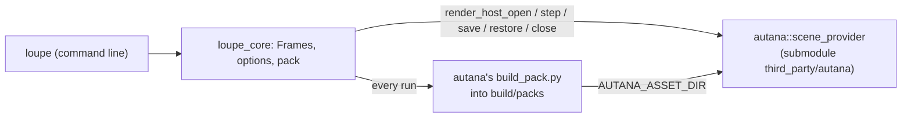

# Loupe

Loupe is a frame debugger for the [autana](https://github.com/jose-villegas/autana)
engine. It runs autana's own drawing code on a desktop, so the frame it shows
is the frame the device draws. Today it renders a scene file to an image or a
video from the command line; a window with a scrubber and a view picker comes next.



## Build

You need GCC (MinGW-w64 on Windows), CMake 3.25 or newer and the Python
autana's pack tool runs on (`third_party/autana/scripts/lib/python-min-version`).

```bash
git clone --recurse-submodules https://github.com/jose-villegas/loupe
cd loupe
pip install -r tools/ci/requirements.txt
cmake --workflow --preset default
```

`cmake --preset default -DAUTANA_DIR=<path>` configures against another autana checkout instead of the submodule.

## Render a scene

```bash
build/default/loupe third_party/autana/launcher/demo/sponza/sponza.scene.toml --view meshlets --frames 60 -o sponza.bmp
```

| Flag | Meaning |
|---|---|
| `--object NAME` | draw only this renderer and its children; repeatable |
| `--camera NAME` | the camera to look through; the scene's first by default |
| `--view NAME` | `shaded` or a debug view; an unknown name lists them |
| `--frames N`, `--dt MS` | how many frames, how far apart (30 at 16 ms) |
| `--set owner.name=value` | a tunable; repeatable |
| `-o out.bmp`, `--video out.avi` | the last frame, every frame |

The flags are autana's `third_party/autana/launcher/tools/render/scene_viewer.sh` flags, and the output is the same bytes.
Each run brings the scene's pack in `build/packs` up to date with autana's `third_party/autana/launcher/tools/r3d/build_pack.py`.

## Tests

The preset's test step (`ctest --preset default`) runs:

| Test | Checks |
|---|---|
| `parity_*` | `loupe` writes the same bytes as autana's scene viewer for the same arguments |
| `seek` | a seek back through a checkpoint draws the bytes stepping straight there drew |
| `include_gate` | only `src/engine/autana.hpp` includes autana's headers |

CI runs them on Linux and Windows at the pinned autana on every pull request,
and nightly against autana's `main`, keeping one issue open while that fails.

## Standards

Loupe is held to autana's code standards by autana's own gates, run from the
submodule: they check the repository they run in. `.github/workflows/standards.yml`
runs them, and [autana's C++ style](third_party/autana/docs/c-style/Cpp.md) is
what they enforce. The build takes its flags, sanitizers and clang-tidy from
`third_party/autana/scripts/cpp/standards.cmake`, and `CMakePresets.json` builds each:

| Preset | Builds and tests |
|---|---|
| `default` | with every warning an error |
| `sanitize` | under UBSan, and ASan on Linux |
| `tidy` | with clang-tidy (`.clang-tidy`) on every C++ file |

```bash
cmake --workflow --preset sanitize
```

The presets use Ninja; `pip install -r tools/ci/requirements.txt` installs it with
the clang-format and clang-tidy autana pins. To run the gates before each commit,
and the sanitized tests before each push that changes C++ or CMake:

```bash
git config core.hooksPath third_party/autana/scripts/git-hooks
```

`.clang-format` and `.clang-tidy` are generated by
`third_party/autana/scripts/cpp/style_configs.py`; CI fails when they drift from the pin.

## License

GPL-3.0, as autana.
