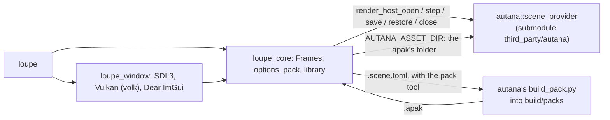

# Loupe

Loupe is a frame debugger for the [autana](https://github.com/jose-villegas/autana)
engine. It runs autana's own drawing code on a desktop, so the frame it shows
is the frame the device draws. It opens a scene in a window with a
timeline and a debug-view picker, or renders it to an image or a video from the
command line. A scene is an asset pack (`.apak`), or a `.scene.toml` Loupe
builds the pack of first.



## Build

You need GCC (MinGW-w64 on Windows), CMake 3.25 or newer and the Python
autana's pack tool runs on (`third_party/autana/scripts/lib/python-min-version`);
without the tests, `-DLOUPE_PACK_TOOL=OFF -DBUILD_TESTING=OFF` builds a Loupe
that opens `.apak` files only and needs no Python.
On Linux, also the packages in `tools/ci/linux-packages.txt`, which
`tools/ci/install-linux-packages.sh` installs. The window draws through Vulkan,
loaded when it opens, so the build needs no Vulkan SDK.

```bash
git clone --recurse-submodules https://github.com/jose-villegas/loupe
cd loupe
pip install -r tools/ci/requirements.txt
cmake --workflow --preset default
```

`cmake --preset default -DAUTANA_DIR=<path>` configures against another autana checkout instead of the submodule.

## Open a scene

```bash
build/default/loupe third_party/autana/launcher/demo/sponza/sponza.scene.toml
```

Run without a scene, the window opens on a start panel: the sample packs beside
`loupe` (`scenes/`, or `../share/loupe/scenes/` when installed), the last 10
scenes opened, and Open... for any other. Scenes, in a scene's window, closes it
and goes back to the panel. The recent list is `recent.txt` in
`%APPDATA%\autana\loupe` on Windows and `~/.local/share/autana/loupe` on Linux.

The window shows the engine's frame at the largest whole zoom that fits. Play
steps one frame per display refresh; the arrows and the scrubber seek through
checkpoints, so a frame sought is the frame stepping straight there drew. The
view picker draws the frame on screen again under another debug view.

## Render a scene

With `-o` or `--video`, Loupe writes the frames and exits, without a window:

```bash
build/default/loupe third_party/autana/launcher/demo/sponza/sponza.scene.toml --view meshlets --frames 60 -o sponza.bmp
```

| Flag | Meaning |
|---|---|
| `--object NAME` | draw only this renderer and its children; repeatable |
| `--camera NAME` | the camera to look through; the scene's first by default |
| `--view NAME` | `shaded` or a debug view; an unknown name lists them |
| `--frames N`, `--dt MS` | how many frames, how far apart (30 at 16 ms) |
| `--set owner.name=value` | a tunable; repeatable |
| `-o out.bmp`, `--video out.avi` | the last frame, every frame |
| `--checkpoint-mb MB` | the window's checkpoint memory (1024); past it, every other checkpoint goes |
| `--ticks N` | closes the window after N ticks, for scripted runs |

The flags but the last two are autana's `third_party/autana/launcher/tools/render/scene_viewer.sh` flags, and the output is the same bytes.
A `.apak` opens as it is: its folder is the asset dir, its name the scene id.
A `.scene.toml` run first brings the scene's pack in `build/packs` up to date
with autana's `third_party/autana/launcher/tools/r3d/build_pack.py`; a build
with `-DLOUPE_PACK_TOOL=OFF` refuses one, and says so.

## Tests

The preset's test step (`ctest --preset default`) builds the packs it opens with `third_party/autana/launcher/tools/r3d/build_pack.py`, then runs:

| Test | Checks |
|---|---|
| `parity_*` | `loupe` on the scene's `.apak` (and, with the pack tool, its `.scene.toml`) writes the same bytes as autana's scene viewer for the same arguments |
| `scene_toml_refused` | without the pack tool, a `.scene.toml` exits 1 saying why |
| `wrong_version_refused` | a pack of another format version exits 1 with autana's reason |
| `relaunch_args` | the command line the window starts loupe again with, on a scene picked after another, parses back to the same run |
| `spawn` | loupe can start its own executable again without waiting on it, arguments intact |
| `library` | the start panel's samples, and a recent list kept most recent first, each once, at most 10 |
| `seek` | a seek back through a checkpoint draws the bytes stepping straight there drew |
| `thinning_*` | under a checkpoint budget the checkpoints stay within it, their interval doubles, and seeks still draw the straight bytes |
| `view_switch` | a debug view picked mid-run, and kept through a seek back, draws what it drew when picked from the start |
| `window_smoke`, `window_start` | the window opens, on a scene and on the start panel, and draws 10 ticks offscreen on Mesa's lavapipe under the Khronos validation layer, with no validation error; skipped where either is missing |
| `include_gate` | only `src/engine/autana.hpp` includes autana's headers |

CI runs them on Linux and Windows at the pinned autana on every pull request,
and nightly against autana's `main`, keeping one issue open while that fails.

## Standards

Loupe is held to autana's code standards by autana's own gates, run from the
submodule: they check the repository they run in. `.github/workflows/standards.yml`
runs them, and [autana's C++ style](third_party/autana/docs/c-style/Cpp.md) is
what they enforce. The build takes its flags, sanitizers and clang-tidy from
`third_party/autana/scripts/cpp/standards.cmake`, and `CMakePresets.json` builds each:

| Preset | Builds and tests |
|---|---|
| `default` | with every warning an error |
| `sanitize` | under UBSan, and ASan on Linux, without the pack tool |
| `tidy` | with clang-tidy (`.clang-tidy`) on every C++ file |

```bash
cmake --workflow --preset sanitize
```

The presets use Ninja; `pip install -r tools/ci/requirements.txt` installs it with
the clang-format and clang-tidy autana pins. To run the gates before each commit,
and the sanitized tests before each push that changes C++ or CMake:

```bash
git config core.hooksPath third_party/autana/scripts/git-hooks
```

`.clang-format` and `.clang-tidy` are generated by
`third_party/autana/scripts/cpp/style_configs.py`; CI fails when they drift from the pin.

## License

GPL-3.0, as autana.
