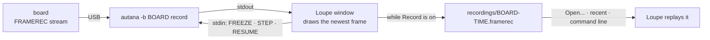

# View a board

A board running a development build of autana streams the render input of every
frame it draws over USB: the views, meshes, poses and settings, and a crc of
each keyframe's picture
([Frame-Record-Format](../../third_party/autana/docs/tools/Frame-Record-Format.md)).
Loupe draws those frames again with autana's own renderer, so a frame from the
board takes the debug views, the cull view and the observer like a scene's.



## From the window

On the start panel, List boards runs `autana devices --json` and lists the
boards plugged in here; the others the board pool knows, seen here before or
named by a lapsed lock, wait under a collapsed "not here". The last list stays
while a new one is asked, and each wait is one line with a spinner and its
seconds. View, on a free board plugged in here, starts `autana -b BOARD
record` and shows its stream live in this window: each tick draws the newest
frame that has arrived, so a backlog is skipped rather than played through.
One line says what the screen is: "Live: BOARD", and "· recording NAME" while
Record saves the frames.

| Control | Sends to the board |
|---|---|
| Freeze board | `FREEZE`: the board's frame loop stops where it is |
| Step board | `STEP`: one more frame, while frozen; that frame waits for room on the board rather than being dropped |
| Unfreeze board | `RESUME`: the frame loop runs again |

Record, beside them, saves the frames from the board's next keyframe on into a
new file, and Stop recording ends that file before the next frame; the view
stays live either way. The panel counts the frames received and how many of
them came right after a drop on the board, and shows autana's reason when the
stream is refused.

Scenes while a board is live ends its link first, and the window shows the
board draining until autana ends; autana gives the board 30 s. Quitting waits
up to 35 s, then ends autana's process.

## Where recordings are kept

Each recording is written as it arrives to
`recordings/<board>-<yyyymmdd>-<hhmmss>.framerec` in Loupe's settings folder
(`%APPDATA%\autana\loupe` on Windows, `~/.local/share/autana/loupe` on Linux),
the board's serial without its colons; a second one within the same second
takes `-2`, `-3`, and so on. A recording joins the recent list when it ends
with a frame in it. `logs/<board>.log` holds `autana record`'s own output for
the last live view of that board.

## From the command line

`autana record` writes the same stream to a file, and a run of Loupe records
the frames it draws itself:

```bash
autana -b BOARD record -o board.framerec
autana -b BOARD record -o ten.framerec --seconds 10
loupe scene.apak --frames 120 --video out.avi --record run.framerec
```

Without `--seconds`, `autana record` reads console lines from its input:
typing `FREEZE`, `STEP` or `RESUME` drives the board as the window's controls
do. It stops when its input ends (Ctrl+Z then Enter on Windows, Ctrl+D on
Linux). With `--seconds` it reads no input and stops after them.

Loupe's `--record` goes beside `-o` or `--video` only; a windowed run,
`--frame` and `--compare` refuse it.

## Replay a recording

A `.framerec` opens like a scene file: on the command line, from Open..., or
from recent. It opens in the window only: `-o` and `--video` refuse one, since
they draw a scene.

```bash
loupe board.framerec
```

The stream names its packs by name and crc. Loupe draws it with every pack a
development firmware of its pinned autana (`third_party/autana`) carries. Its
build makes them with `build_pack.py` (`cmake/firmware_packs.cmake`) whenever
the pin moves, and an install carries them beside the samples, so a recording
or a replay waits for none. A loupe without them builds them with its pack tool
into the pack cache, once per pin. A pack missing from them, or
whose crc differs from the board's, refuses the stream, saying which: the board
runs another build. So the board runs a build of the pinned commit: from that
checkout, `autana flash dev`.
