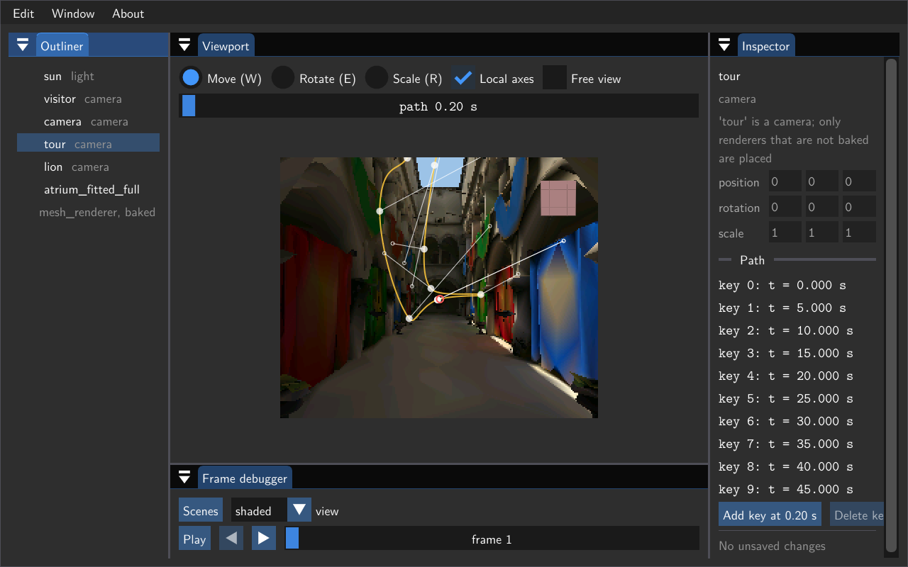
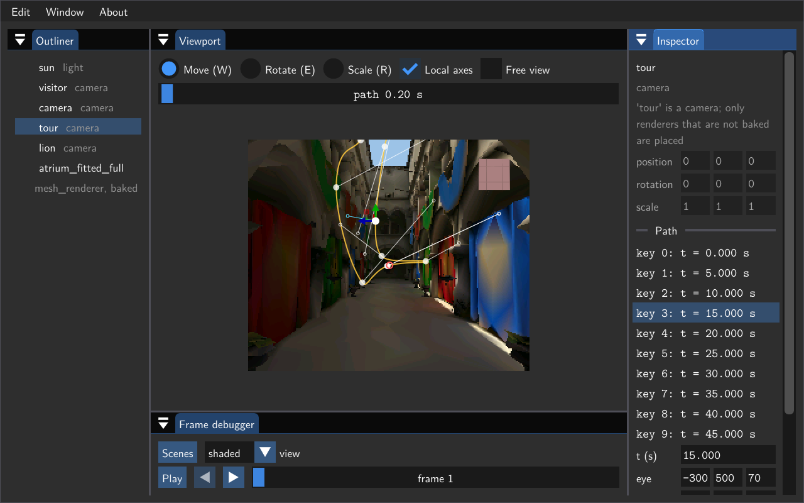
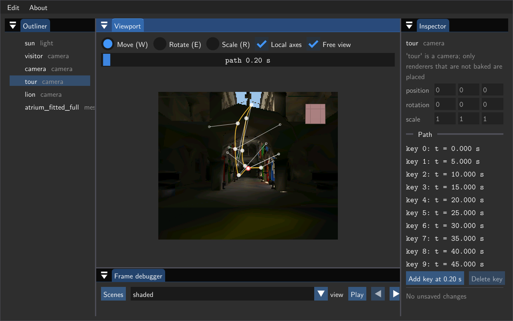
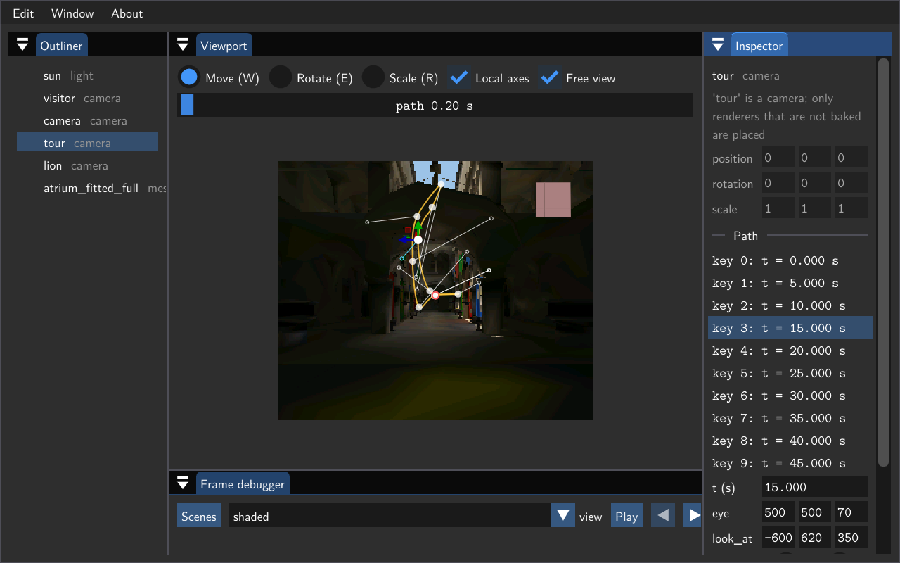
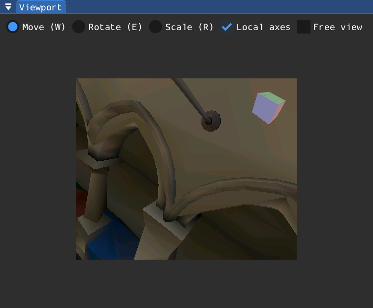
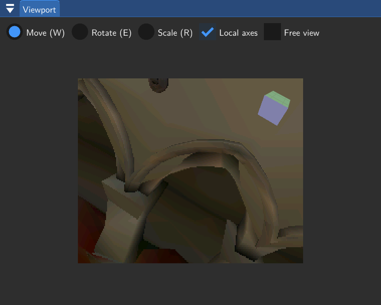
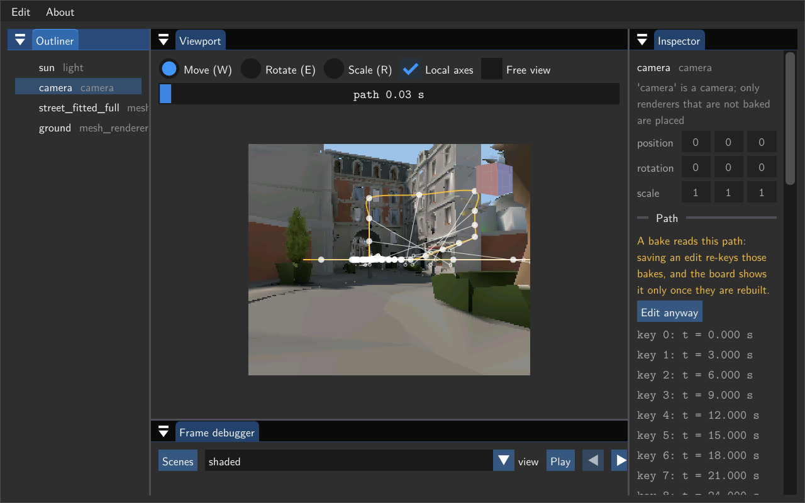

# Camera paths

A camera whose path is a `.keys.toml` shows that path when selected: the
curve the camera flies, each key's eye and look_at joined, and a handle on the
picked point (a click near a point picks it). The Inspector lists the keys and
edits the picked key's time, eye and look_at; Add key puts one on the curve at
the shown frame's time, and Delete key removes the picked one. A path that
loops keeps its ends together. The scrub bar seeks to the frame at the time
picked on the path. Free view flies the active camera by the observer's
steering, so the path can be seen from outside.

While a path differs from the one the pack was built with, the camera flies
the edited path on every frame, and lands back on its clip when the path is
the pack's again. Save writes each changed path with `scene_edit.py set-keys`,
which keeps the file's comments and each kept key's lines, then runs the bake
check. A path a bake reads, such as one a probe fit samples, asks before the
first edit. A path from a `.glb` clip is shown, not edited.

| | |
|---|---|
|  |  |
| The tour selected: its curve, each key's eye joined to its look_at, the scrub bar and the Inspector's keys | Key 3 picked: the handle on its eye, its row and its time, eye and look_at in the Inspector |
|  |  |
| Free view, flown back from the scene's camera so the whole tour is in sight | Key 3's eye moved: the curve bends to it, and the change is unsaved |
|  |  |
| Through the tour at 18 s, on the path the pack was built with | The same frame with key 3's eye moved: the camera flies the edited path |
|  | |
| Bistro's street path, which a bake reads: the Inspector asks before the first edit | |
