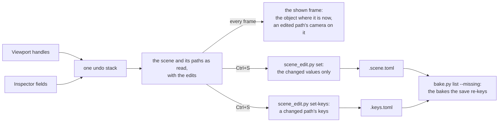
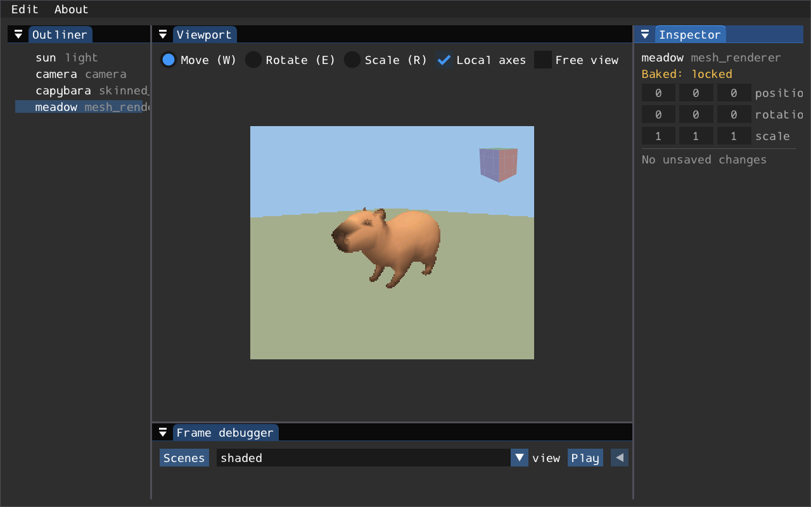

# Edit a scene

A `.scene.toml` opens as docked panels:

| Panel | Shows |
|---|---|
| Viewport | the frame, the move, rotate and scale handles on the selected object (W, E, R; along its own axes or the world's), and a cube showing which way the camera looks; for a camera on a path, the path, a scrub bar over it and the Free view |
| Outliner | the scene's objects by parent, each with its kind, and whether it is baked |
| Inspector | the selected object's position, rotation in degrees and scale as numbers, why it may not move when it may not, a camera path's keys, whether anything is unsaved, then the last save and which bakes it re-keys |
| Frame debugger | Scenes, the view picker, the observer and the timeline, as [Open a scene](Open-a-Scene.md) describes |

A click on a name in the Outliner, or on the frame (the object whose origin
lies nearest the click), selects an object. A drag of a handle or a field, from
any panel, is one step of Edit's undo (Ctrl+Z; Ctrl+Y or Ctrl+Shift+Z redoes).
The frame shows the object where it is now on every frame sought or played;
each move of a drag draws one engine frame, from a checkpoint held just before
the shown frame.

What may move is what autana's
`third_party/autana/launcher/tools/scene/scene_edit.py` will write: renderers
that are not baked, such as a skinned one. A baked renderer's lighting was
traced with it where it sits, so moving it would leave that lighting behind;
the Inspector shows it locked. Lights and cameras keep their placement; the
tool places only renderers. The Inspector gives the tool's reason for each:
on the "Baked: locked" badge's tooltip for a baked renderer, beneath the name
for the others.

Save (Ctrl+S) writes the moved values into the `.scene.toml` with that tool,
which keeps the file's comments and layout and changes only those values. Then
`third_party/autana/launcher/tools/bake/bake.py list --missing` names the bakes
the saved scene re-keys, in the Inspector; moving a skinned or
unbaked object re-keys none. A save the tool refuses leaves the file as it was
and the change unsaved, and the Inspector says why. A pack (`.apak`) has no
scene file, so it opens without the editor, and so does a build without the
pack tool.
